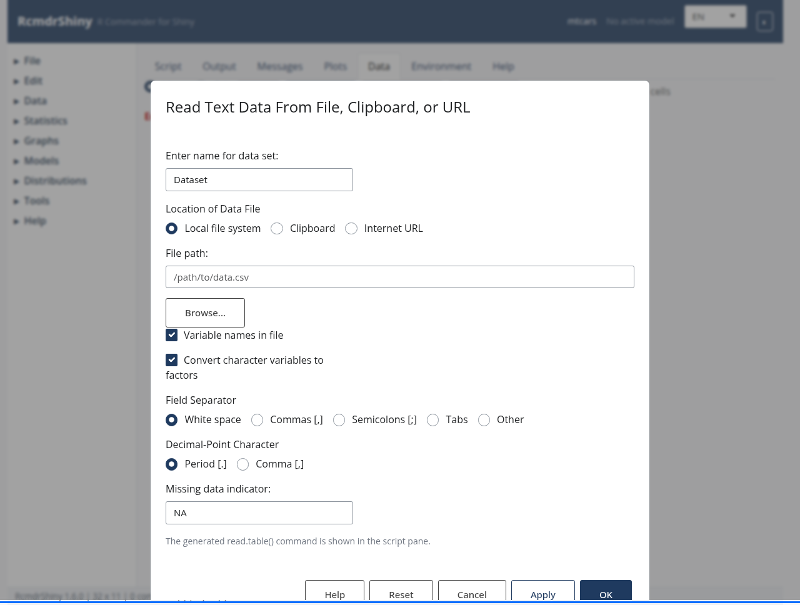

```{r setup, include = FALSE}
knitr::opts_chunk$set(eval = FALSE, comment = "#>")
```

The text import dialog.

```{r screenshot, echo = FALSE, eval = TRUE, out.width = "100%"}

```

## Why start here

Every RcmdrShiny analysis begins with a data set.  The import dialogs read a
file, make the result the active data set and write the equivalent R command to
the **Script** tab, so the step is reproducible.

## Text files

**Data > Import data > from text file, clipboard, or URL...** covers CSV,
tab-separated and whitespace-separated files, the clipboard and URLs.

```{r}
Survey <- read.table("data/survey.csv", header = TRUE, sep = ",",
                     na.strings = "NA")
```

Set the separator, the decimal mark and the missing-value string before
confirming.  If a column that should be numeric arrives as a factor, check for
a stray header row or a thousands separator.

## Spreadsheets and statistical packages

| Format | Dialog | Requires |
|---|---|---|
| Excel | from Excel file... | `readxl` |
| SPSS | from SPSS data set... | `foreign` |
| Stata | from Stata data set... | `foreign` |
| SAS | from SAS data set... | `foreign` |
| Minitab | from Minitab data set... | `foreign` |

The dialogs are enabled only when the supporting package is installed.

## Data sets shipped with R

**Data > Read data set from an attached package...** lists the data sets of the
installed packages.  This is the quickest way to try an analysis:

```{r}
data(mtcars)
```

## Cleaning

- **Compute new variable...** derives a column from an expression.
- **Recode variables...** maps old values to new ones.
- **Subset active data set...** keeps rows that satisfy a condition.
- **Drop unused factor levels...** removes levels with no observations, which
  prevents the `contrasts can be applied only to factors with 2 or more levels`
  error in models.

```{r}
Dataset <- subset(Dataset, !is.na(response))
Dataset$group <- droplevels(Dataset$group)
```

## Checking the result

Use **Statistics > Summaries > Active data set** for a quick structural check,
then **Numerical summaries...** and **Frequency distributions...** for the
variables you plan to model.

```{r}
str(Dataset)
summary(Dataset)
```

## See also

The in-app help topic `data-import` covers the same material with the exact
menu labels, and `data-editing` lists every transformation dialog.
