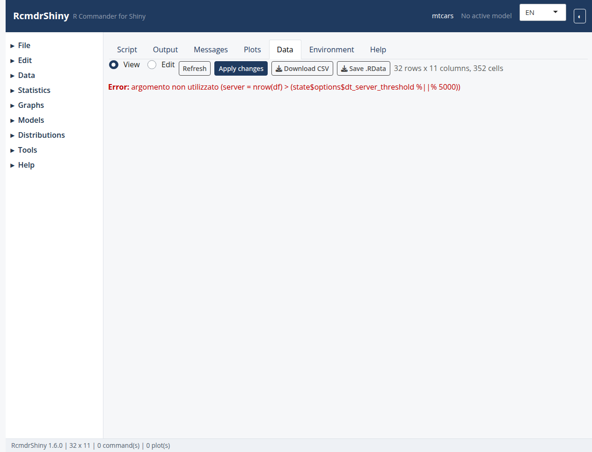

```{r setup, include = FALSE}
knitr::opts_chunk$set(eval = FALSE, comment = "#>")
```

The Data tab with the active data set.

```{r screenshot, echo = FALSE, eval = TRUE, out.width = "100%"}

```

## A first look at the data

Descriptive statistics answer three questions: what is in the data, how are the
variables distributed, and are there missing or impossible values?

In RcmdrShiny the entry points are:

- **Statistics > Summaries > Active data set** — `summary()` for every column.
- **Statistics > Summaries > Numerical summaries...** — means, standard
  deviations, quantiles and missing counts for numeric variables.
- **Statistics > Summaries > Frequency distributions...** — counts and
  percentages for factors.
- **Statistics > Summaries > Table of statistics...** — a statistic of one
  variable broken down by one or two factors.

## Numerical summaries

```{r}
numSummary(mtcars[, c("mpg", "hp", "wt")],
           statistics = c("mean", "sd", "quantiles", "missing"))
```

With a grouping factor the dialog adds `groups = Dataset$factor`, producing one
row per level.

## Frequency distributions

```{r}
local({
  .Table <- with(mtcars, table(cyl))
  print(.Table)
  print(round(100 * .Table / sum(.Table), 2))
})
```

The goodness-of-fit variant appends a chi-square test against expected
proportions.

## Cross tables

```{r}
local({
  .Table <- xtabs(~ cyl + am, data = mtcars)
  print(.Table)
  print(rowPercents(.Table))
  print(chisq.test(.Table, correct = FALSE))
})
```

## Graphs

Descriptives are easier to read next to a plot:

- **Graphs > Histogram...** for the shape of a numeric variable.
- **Graphs > Boxplot...** for quartiles and outliers by group.
- **Graphs > Scatterplot...** for the joint distribution of two variables.

## Reporting

Every table above is printed in the **Output** tab.  Copy the commands from the
**Script** tab into an R Markdown document to reproduce the tables in a report,
and use the `Export` plugin for LaTeX tables.

## See also

In-app topics: `numerical-summaries`, `frequency-distributions`,
`cross-tables`, `histogram`.
