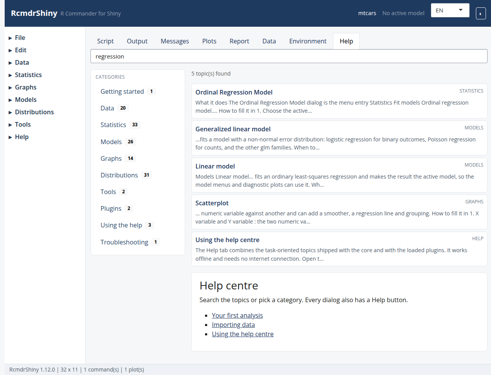

```{r setup, include = FALSE}
knitr::opts_chunk$set(eval = FALSE, comment = "#>")
```

## Two kinds of script

The Script tab holds either a plain R script or a document.  The selector at
the top switches between **R script**, **R Markdown** and **knitr**.  Switching
converts the buffer without losing code: a script becomes a chunk in the
document, and a document becomes a script when you switch back.

The R Markdown mode is the one most users need: it combines prose, code chunks
and the rendered output in a single file.

```{r screenshot, echo = FALSE, eval = TRUE, out.width = "100%"}

```

## A complete workflow

1. Choose **R Markdown** in the Script tab.
2. Add a section with the **Section** button.
3. Use the menus as usual: every dialog appends its commands as a chunk.
4. Press **Knit** and choose HTML, PDF or Word.
5. The result opens in the **Report** tab and can be downloaded.

The same actions are available from the menus:

| Action | Menu |
|---|---|
| New document | File > New R Markdown document... |
| Open | File > Open R Markdown file... |
| Save / Save as | File > Save R Markdown file... / ... as... |
| Knit | File > Knit document... |
| Switch to R Markdown | Edit > Edit R Markdown document |
| Remove the last chunk | Edit > Remove last Markdown command block |
| Remove the last heading | Edit > Remove last Markdown section title |

## What the dialogs generate

A numerical summary becomes a chunk:

```r
summary(mtcars)
```

or, with several commands:

```r
numSummary(mtcars[, c("mpg", "hp")],
           statistics = c("mean", "sd", "quantiles", "missing"))
```

The chunk is ordinary R Markdown, so the document can be opened in RStudio,
VS Code or any editor.

## Knitting

**File > Knit document...** renders the document in the current session, so it
sees the active data set and models.  The formats depend on external tools:

| Format | Requires |
|---|---|
| HTML | `rmarkdown`, `knitr`, Pandoc |
| PDF | the above plus LaTeX (`pdflatex`) |
| Word | `rmarkdown`, `knitr`, Pandoc |

A knitr `.Rnw` document is converted with `knitr::knit()` and then compiled
with LaTeX.

The knit dialog only offers the formats that are installed.  If PDF is
missing, install a LaTeX distribution such as TinyTeX:

```r
install.packages("tinytex")
tinytex::install_tinytex()
```

## Security

Knitting **runs the code in the document** in your R session.  Treat a
document like a script: only knit files you wrote or trust.

## The alternative: session report

If you do not need a document you can edit, **File > Export report...** builds
an R Markdown or HTML report from the command log, the output and the plots of
the session.  It is the fastest route from an analysis to a shareable file.

## See also

In-app topics: `document-authoring`, `exporting-results`.

The `rmarkdown` and `knitr` documentation covers chunk options, tables,
citations and the other output formats.
