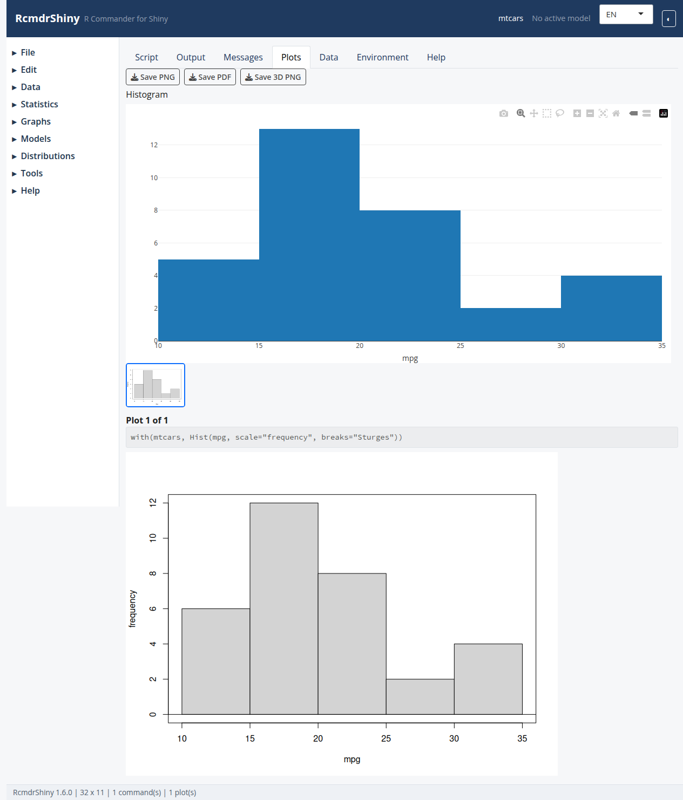

```{r setup, include = FALSE}
knitr::opts_chunk$set(eval = FALSE, comment = "#>")
```

A plot captured in the Plots tab.

```{r screenshot, echo = FALSE, eval = TRUE, out.width = "100%"}

```

## How plots work

RcmdrShiny captures every plot into the **Plots** tab as an image.  The tab
keeps a gallery of the plots produced in the session and offers **Save PNG** and
**Save PDF**.

Because the command is written to the **Script** tab, the same plot can be
reproduced outside the application:

```{r}
with(mtcars, Hist(mpg, scale = "frequency", groups = factor(cyl)))
```

## Base graphics

| Dialog | Function |
|---|---|
| Histogram | `Hist()` |
| Boxplot | `Boxplot()` |
| Scatterplot | `scatterplot()` |
| Bar graph | `Barplot()` |
| Pie chart | `piechart()` |
| Line graph | `lineplot()` |
| Quantile-comparison plot | `qqPlot()` |
| Plot of means | `plotMeans()` |
| Strip chart | `stripchart()` |
| Density estimate | `densityPlot()` |

## Lattice graphics

- **XY conditioning plot** builds `lattice::xyplot()` panels for each
  combination of conditioning factors.
- **Dot plot** and **symmetry boxplot** are also lattice-based.

```{r}
lattice::xyplot(mpg ~ wt | factor(cyl), data = mtcars, layout = c(3, 1))
```

The `lattice` package must be installed; the menu entry is disabled otherwise.

## 3D graphics

**Graphs > 3D scatterplot...** uses `rgl` and renders an interactive scene in
the browser.  The **Plots** tab offers a snapshot export.

## Themes and palettes

**Graphs > Color palette...** sets the palette used by subsequent base plots.
The `KMggplot2` plugin adds ggplot2-based versions of the common plots.

## Saving and reusing

1. Produce the plot with a dialog.
2. Save it from the **Plots** tab, or
3. copy the command from **Script** and add `pdf()` / `png()` around it in a
   script.

## See also

In-app topics: `histogram`, `scatterplot`.
