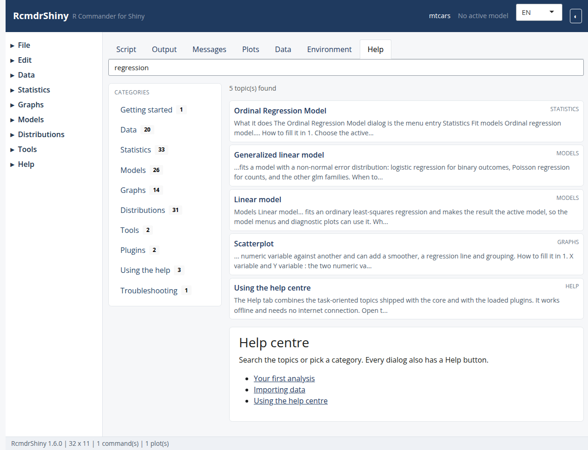

```{r setup, include = FALSE}
knitr::opts_chunk$set(eval = FALSE, comment = "#>")
```

The Help tab showing a search result.

```{r screenshot, echo = FALSE, eval = TRUE, out.width = "100%"}

```

## How help is organised

Help lives in `inst/help-topics/`:

```text
inst/help-topics/
├─ index.yml        manifest: categories and topics
└─ topics/
   ├─ linear-model.md
   └─ it/
      └─ linear-model.md
```

Each topic is Markdown with a YAML front matter.  The same format is used by the
core and by plugin packages (`plugins/<pkg>/inst/help-topics/`).

## Create a topic

```{bash, eval = FALSE}
Rscript tools/new_help_topic.R my-topic \
  --title "My topic" \
  --category statistics \
  --dialogs myDialog \
  --commands myCommand
```

The script writes the file, adds it to `index.yml` and leaves the status at
`draft` until a reviewer promotes it to `documented`.

## Front matter

```yaml
---
id: my-topic
title: My topic
type: task
category: statistics
keywords: [keyword, synonym]
aliases: [short-name]
dialogs: [myDialog]
commands: [myCommand]
packages: [myPackage]
related: [other-topic]
language: en
status: documented
---
```

`dialogs` is what makes the dialog's **Help** button open the topic.  A topic can
list several dialogs, which is how grouped topics such as the distribution
families work.

## Writing style

- Lead with the task, not the function.
- Use the same menu labels the interface shows.
- Always include the generated command in a fenced `r` block.
- Link related topics with `[label](topic:other-topic)`.
- Keep the Rd file as the technical reference; the topic teaches the workflow.

## Check coverage

```{bash, eval = FALSE}
Rscript tools/inventory_help.R
Rscript tools/check_help_links.R --strict
```

`inventory_help.R` writes `inst/etc/help-inventory.csv` with one row per dialog
and the status `documented`, `draft`, `fallback` or `missing`.  The CI job
fails when a dialog has neither a topic nor an Rd fallback.

## Translations

Put a translated copy under `topics/<language>/` with the same `id` and
`language: <code>`.  The registry falls back to English for any topic that has
not been translated, so partial translations are safe.

## Test the change

```{r}
testthat::test_local(".", filter = "help")
```

The tests cover the manifest parser, the registry, search ranking and rendering.

## See also

In-app topics: `writing-help-topics`, `writing-plugins`.
