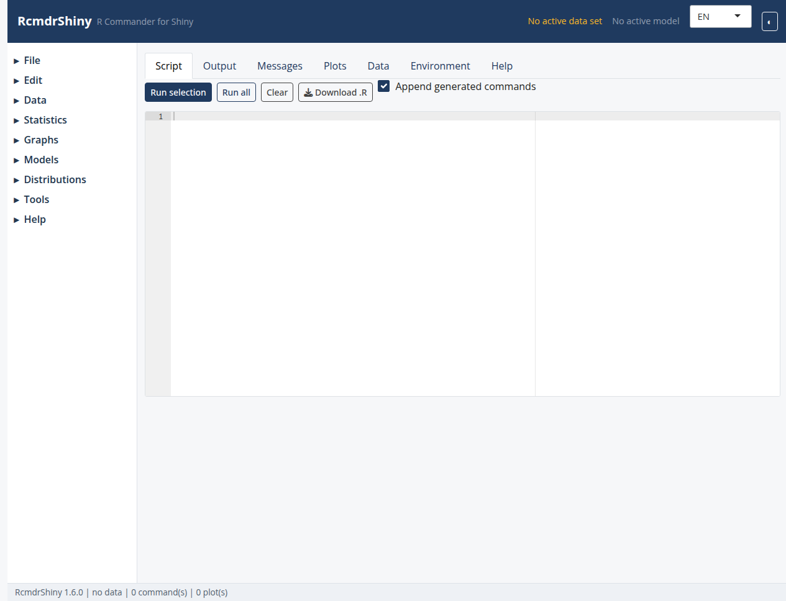

```{r, include=FALSE}
knitr::opts_chunk$set(collapse = TRUE, comment = "#>", eval = FALSE)
```

The application with the core menus; plugins add their own.

```{r screenshot, echo = FALSE, eval = TRUE, out.width = "100%"}

```

An RcmdrShiny plugin adds menus, direct commands and Shiny dialogs.  Plugins can
be delivered as a single R script or, preferably, as an R package named
`RcmdrShinyPlugin.<Name>`.

# Package layout

```text
RcmdrShinyPlugin.Export/
├─ DESCRIPTION
├─ NAMESPACE
├─ R/plugin.R
├─ R/dialogs.R
├─ inst/etc/rcmdrshiny-menus.txt
├─ man/
└─ tests/testthat/
```

`tools/new_plugin.R` creates the skeleton:

```bash
Rscript tools/new_plugin.R Export --title "Export R output" \
  --upstream RcmdrPlugin.Export
```

The package must depend on `RcmdrShiny (>= 1.1.0)`, export
`rcmdrshiny_plugin()`, and must not import `tcltk` or `tcltk2`.

# Menu file

Plugin menus use the same tabular format as `Rcmdr-menus.txt`:

```text
    menu    demoMenu        topMenu         ""                          ""          ""  ""
    item    demoMenu        command         "Demo: Hello"               demoHello   ""  ""
    item    demoMenu        command         "Demo: Shiny dialog"        demoDialog  ""  ""
    item    topMenu         cascade         "Demo plugin"               demoMenu    ""  ""
```

The first column is `menu`, `item` or `remove`; the remaining columns follow
Rcmdr's conventions for parent, label, command, activation and installation
expressions.  Items can be inserted into the core menus (for example
`item helpMenu command ...`) and `remove menuId` deletes an existing menu with
its children.  Top-level cascades are placed before Tools and Help.

# Registering the plugin

```r
#' @export
rcmdrshiny_plugin <- function() {
  RcmdrShiny::RcmdrShiny.plugin(
    name = "RcmdrShinyPlugin.Demo",
    menus = system.file("etc", "rcmdrshiny-menus.txt",
                        package = "RcmdrShinyPlugin.Demo"),
    commands = list(
      demoHello = function(state) {
        RcmdrShiny::run_command(state, 'cat("Hello from the plugin\\n")')
      }
    ),
    dialogs = list(
      demoDialog = RcmdrShiny::plugin_dialog(
        id = "demoDialog",
        title = "Demo dialog",
        ui = function(state, memory) {
          htmltools::tagList(
            RcmdrShiny::var_input(
              "demoDialog_var", "Variable",
              RcmdrShiny::numeric_variables(state)
            )
          )
        },
        on_ok = function(input, state) {
          list(commands = "1 + 1")
        }
      )
    ),
    predicates = list(
      hasDemoData = function() requireNamespace("datasets", quietly = TRUE)
    )
  )
}
```

`on_ok()` can return `commands`, `error`, `memory`, `activate_dataset`,
`activate_model`, `script`, `tab` or `message`, exactly like the built-in
dialog runtime.  `plugin_dialog()` forwards `help` and `help_package` to the
dialog's Help button.

# Activation predicates

The `predicates` argument binds plugin functions in the menu activation
environment, so they can be used in the `activation` column.  A predicate can
take no arguments, or the application state, and must return a logical value.

```text
item    demoMenu    command    "Demo"    demoCommand    "hasDemoData()"    ""
```

Commands, dialogs and predicates cannot silently shadow core or earlier plugin
names.  Pass `replace = TRUE` only when a deliberate override is intended.

# Plugin helpers

Plugin packages can use the exported state accessors and widgets:

- `variables()`, `numeric_variables()`, `factor_variables()`, `dataset()`;
- `active_dataset()`, `active_model()`, `AppState()`, `run_command()`;
- `plugin_formula()` to build formula strings;
- `var_input()`, `checkbox_input()`, `checkboxes_input()`, `radio_input()`,
  `entry_input()`, `spin_input()`, `slider_input()`, `combo_input()`,
  `subset_input()`, `file_input()` and `dir_input()`;
- `tr()` and `available_languages()` for translation.

# Loading plugins

Package plugins are loaded by name:

```r
RcmdrShiny::run(plugins = "RcmdrShinyPlugin.Export")
```

Script plugins remain supported:

```r
RcmdrShiny::run(plugins = "path/to/plugin.R")
```

Several plugins can be combined:

```r
RcmdrShiny::run(plugins = c(
  "RcmdrShinyPlugin.Export",
  "RcmdrShinyPlugin.sos"
))
```

Or use *Tools > Load Rcmdr plug-in(s)...*.  Menus are read at startup, so a
plugin loaded in a running session requires a restart.

# Legacy Tk plugins

`load_plugin_package()` also detects legacy `RcmdrPlugin.*` packages that
provide `etc/menus.txt`.  They are registered with a warning, but Tk dialog
functions are not executed and their entries remain disabled.

# Inventory and tests

`tools/inventory_plugin.R` lists every menu entry in an upstream plugin, the R
function behind it, whether it uses Tk and whether it generates commands:

```bash
Rscript tools/inventory_plugin.R /path/to/RcmdrPlugin.Export
```

A plugin package should include golden tests for the generated commands and a
test that `rcmdrshiny_plugin()` registers with `RcmdrShiny`.

# Example

`system.file("examples", "demo-plugin.R", package = "RcmdrShiny")` contains a
small script plugin together with `demo-menus.txt`.
