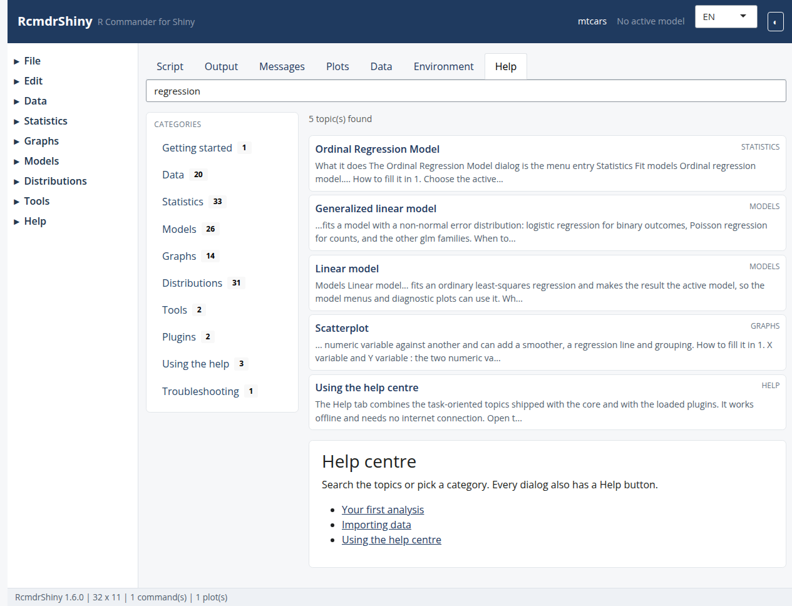

```{r setup, include = FALSE}
knitr::opts_chunk$set(eval = FALSE, comment = "#>")
```

The Help tab, which works offline.

```{r screenshot, echo = FALSE, eval = TRUE, out.width = "100%"}

```

## Menus are greyed out

Most commands need an active data set.  Import or select one first.  Model
commands additionally need an active model, created by a successful model
dialog.

## A command failed

Errors appear in the **Messages** tab; dialog errors open a modal with a
**Retry** button that keeps the values you entered.

| Message | Fix |
|---|---|
| `object 'x' not found` | The variable or data set was renamed |
| `contrasts can be applied only to factors with 2 or more levels` | Drop unused levels |
| `NA/NaN/Inf in 'y'` | Remove or impute missing values |
| `there are aliased coefficients in the model` | Remove collinear predictors |
| `cannot allocate vector of size` | The data set is too large for the session |

## Plots do not appear

Plots are captured into the **Plots** tab.  If the tab stays empty, check the
**Messages** tab: a graphics package may be missing (`rgl` for 3D plots,
`ggplot2` for KMggplot2).

## A plugin does not load

```{r}
requireNamespace("RcmdrShinyPlugin.Export")
utils::packageVersion("RcmdrShiny")
```

- Plugins require `RcmdrShiny (>= 1.1.0)`.
- Read the warnings printed at load time: they name skipped menu entries.
- EZR replaces the core menus by design.

## Help looks incomplete

```{r}
length(RcmdrShiny::help_topics())
RcmdrShiny::help_search("regression")
```

If a topic is missing, the dialog falls back to its Rd page.  Run
`Rscript tools/inventory_help.R` in the source repository to see the coverage.

## Capture a diagnostic report

**Help > Diagnostics** collects versions, plugins and options.

```{r}
cat(RcmdrShiny::format_diagnostics(), sep = "\n")
```

Include the output when opening an issue at
<https://github.com/vigliafg/rstats-commander/issues>.

## Reset the session

```{r}
RcmdrShiny::unload_plugins()
```

Then restart the R session if the state still looks inconsistent.

## See also

In-app topics: `troubleshooting`, `keyboard-shortcuts`.
